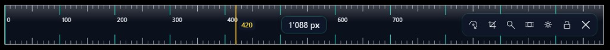
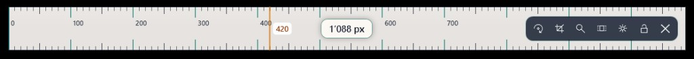
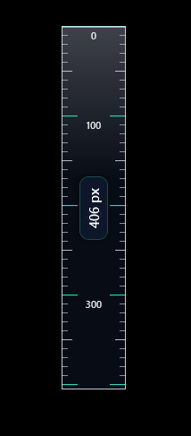
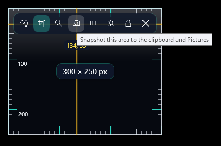
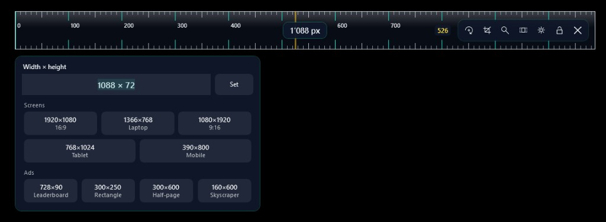

# Screen Ruler

A translucent ruler for measuring pixels on Windows and Mac.

## Screenshots

Horizontal ruler, dark glass. The number in the middle is the length. The hairline follows the pointer.

The same ruler with light ticks.

Flip it to measure height.

Mark an area, then snapshot it. The picture is copied to the clipboard and saved under Pictures\ScreenRuler.

Double-click the size to type a width and height, or pick a screen or ad preset.

## Install on Windows

1. Open the [latest release](https://github.com/idealizer/screenruler/releases/latest).
2. Download `ScreenRuler-Setup-1.0.0.exe` (the name includes the version).
3. Double-click the file and follow the steps. Windows does not ask for an administrator password.
4. Leave **Launch Screen Ruler** checked, or open **Screen Ruler** from the Start menu afterwards.

A desktop shortcut is optional. The installer leaves that box unchecked.

Windows shows “Windows protected your PC” the first time someone downloads it, because the file is not signed. Choose **More info**, then **Run anyway**. The ruler does not ask again after that.

## Install on Mac

1. Download [ScreenRuler-macOS.zip](https://github.com/idealizer/screenruler/releases/download/v1.0.0/ScreenRuler-macOS.zip).
2. Unzip it and move **Screen Ruler** to the Applications folder.
3. The first time, Control-click the app and choose **Open**, then choose **Open** again. macOS says it is from an unidentified developer because the app is not notarized.
4. The ruler floats above other windows. Escape hides it in the menu bar. Command-Option-R brings it back. Quit from the menu bar icon.

Command-F or Control-F flips the bar. Command-1, Command-2, and Command-3 switch to width, height, and area. Scroll to change the glass. Double-click the size to type a width and height, or pick a preset.

Zoom and snapshots ask for Screen Recording once. The ticks themselves do not need that permission.

## Remove

On Windows, open **Settings → Apps → Installed apps**, find **Screen Ruler**, and uninstall it.

On a Mac, quit Screen Ruler from the menu bar icon, then move the app to the Trash.

## Requirements

Windows 10 or Windows 11, 64-bit. No separate .NET install.

macOS 13 or newer.
